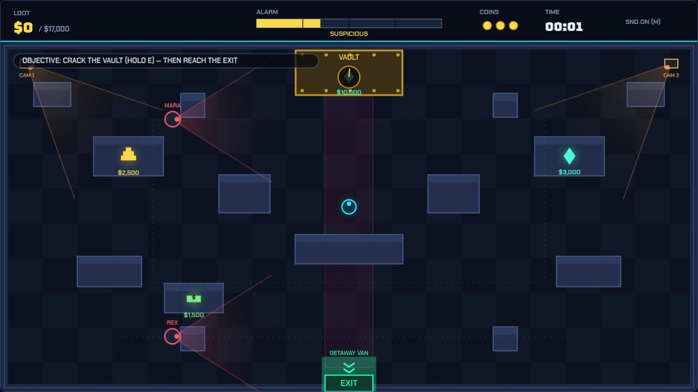

# Neon Vault Heist — The Meridian Job

A complete, original 2D stealth-heist game in the browser, built for the
[make.fun best heist game bounty](https://make.fun/bounty/best-heist-game-20261122-0559).
One room, one thief, one way out: crack the vault, grab the Meridian Diamond,
and reach the exit before the guards — or the cameras — fill the alarm meter.

## How to play

Open `game/index.html` in a desktop browser (or serve `game/` from any static
server). No network, no build step, no install.

| Input | Action |
| --- | --- |
| WASD / arrow keys | Move the thief |
| Shift | Sprint (faster, but the patrols still see you) |
| Mouse click | Throw a coin — the nearest guard goes to investigate (3 coins) |
| E (hold, at the vault) | Crack the vault — 2.2 seconds of standing still |
| M | Mute / unmute the synthesized sound |
| R | Restart the run |
| Enter / click | Start from the title screen |

## The job

- **The room:** the Meridian Gallery after dark. Display cases, crates, a long
  central table, pillars and sofas — every one of them blocks movement *and*
  vision, so the room has a left, a centre and a right route to the vault.
- **The patrols:** Mara walks a loop around the middle of the room and Rex
  beats along the south wall by the exit. Both pause at every waypoint to
  sweep their vision cones. A dotted line shows each patrol route, so you read
  the cones before you move.
- **The cameras:** two wall cameras sweep the north half of the room out of
  phase with each other. Their cones turn hot red while they see you.
- **The alarm meter:** it rises while any guard or camera sees you (faster up
  close) and decays while nobody does. At 100 it trips: the siren sounds and
  both guards hunt you. You can still win by reaching the exit — a loud
  getaway pays less than a clean one.
- **The loot:** the Meridian Diamond ($10,000, in the vault — the only prize
  that takes time), gold bars ($2,500), an emerald idol ($3,000) and a cash
  stack ($1,500). Score adds time, clean-getaway and coins-kept bonuses, and
  ranks the run S, A, B or C.
- **The getaway:** reach the exit door with the diamond. Getting caught — a
  guard laying a hand on the thief — ends the run.

## Structure

Static files under `game/`, loaded with no network request. The source is
split by job so each file does one thing:

- `game/index.html` — the page and the 1280×720 canvas
- `game/styles.css` — page chrome and the Bungee / Chakra Petch display fonts
- `game/src/main.js` — the game loop, state machine, input and scoring
- `game/src/world.js` — the room layout, tuning and geometry helpers
- `game/src/thief.js` — the player: movement, coins, vault cracking, loot
- `game/src/guards.js` — patrol, sweep, investigate and chase AI
- `game/src/cameras.js` — the sweeping security cameras
- `game/src/alarm.js` — the alarm meter
- `game/src/audio.js` — all sound synthesized with WebAudio (no audio files)
- `game/src/render.js` — every pixel: room, cones, actors, HUD and screens

`main.ts` (at the repo root) hands the game in: it copies `game/` and
`screenshots/` to the output directory and writes `dossier.json` with the
kit's `buildDossier`.

## Screenshots

All four are real renders of the game's own code, taken in headless Chrome
with the CDP play-test (`?shot=` stages each scene: cover, vault, alarm, win).

## Play-test

A headless-Chrome CDP harness drives the real game before every hand-in:
title → start → walk → coin throw → loot pickup → vault crack → win, plus
alarm rise and decay inside a vision cone, the busted screen on contact, and
restart. 30 checks, all passing, zero page errors.

## License

MIT — see [LICENSE](LICENSE).
